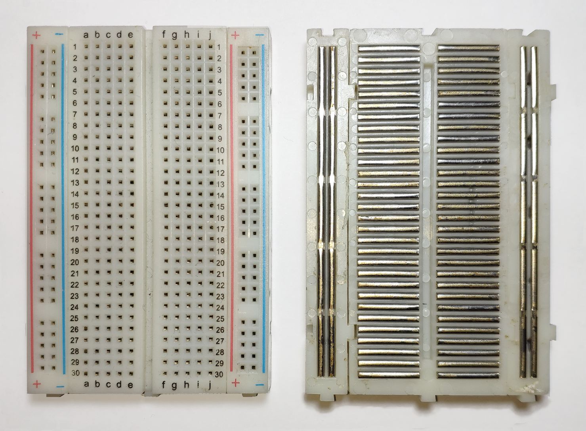
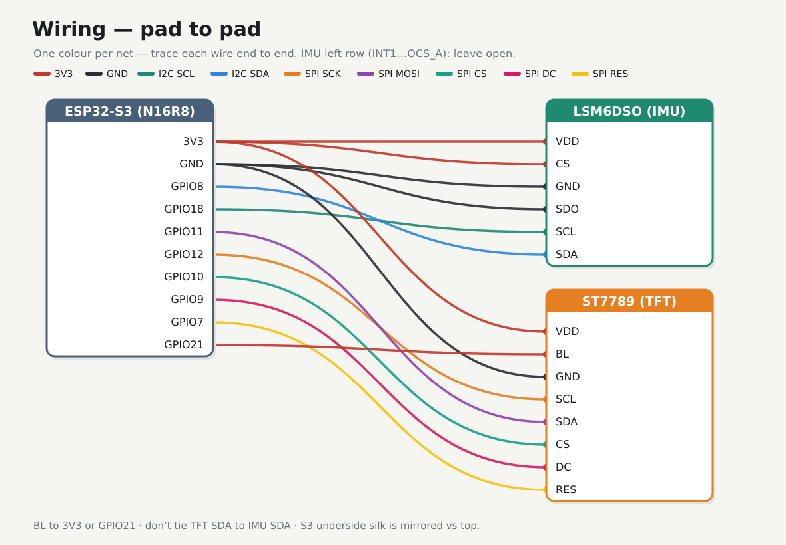

# Hardware reference

## Parts

| Role | Part | Notes |
|------|------|-------|
| MCU | ESP32-S3 DevKitC-1 class | Dual Type-C N16R8 |
| IMU | LSM6DSO / LSM6DSX | 6-axis, I2C at 0x6A |
| Display | ST7789 | Estardyn 2.0″ |
| Breadboard | Any solderless | Half-size 400 or full 830 |
| Jumpers | DuPont | M–M for board↔board / board↔rail |

## Breadboard (default connectivity)

Nothing is “wired” yet — the plastic board already has metal clips under the holes. Know that map **before** Phase 2, or a star becomes accidental shorts.



| Region | How holes are tied (factory default) |
|--------|--------------------------------------|
| Terminal strips | Each **row** of five (`a–e` or `f–j`) is one net. Same-number left and right are **not** joined — the centre trench isolates them. |
| Power rails | The `+` column is one vertical net; the `−` column is another. Red/`+` → **3V3**, blue/`−` → **GND** in this lab. |
| Rail gaps | Many boards break each rail halfway. Bridging the gap with a short jumper makes one continuous rail. |

Pick one `+` rail and one `−` rail as the 3V3/GND star. Run S3 **3V3** and **GND** into those rails once, then tap modules from the rails — don’t daisy-chain module-to-module for power.

Credit: connections photo [Guhuru](https://commons.wikimedia.org/wiki/File:Breadboard.png) (CC0); empty board [oomlout](https://commons.wikimedia.org/wiki/File:400_points_breadboard.jpg) (CC BY-SA 2.0).

## Wiring diagram (pad-to-pad)



Every net, colour-coded. Prefer the [pad-to-pad photo overlay](./assets/wiring-diagram-real.png) if you’d rather trace wires on the real board silk.

### Bench cheat sheet

```
ESP32-S3          LSM6DSX                 ST7789
--------          -------                 ------
3V3        -----> VDD, CS                 VDD, (BL)
GND        -----> GND, SDO                GND
GPIO8      -----> SDA
GPIO18     -----> SCL
GPIO11     -----------------------------> SDA (MOSI)
GPIO12     -----------------------------> SCL (SCK)
GPIO10     -----------------------------> CS
GPIO9      -----------------------------> DC
GPIO7      -----------------------------> RES
GPIO21     -optional--------------------> BL
```

### Rules

- I2C address **0x6A**: IMU **CS→3V3**, **SDO→GND**
- Do **not** join TFT SDA to IMU SDA
- IMU left row (`INT1`…`OCS_A`): leave open for v1
- Avoid GPIO **0 / 19 / 20 / 38 / 48 / 45 / 46** (and **35–37** on Octal PSRAM)
- S3 underside silk is mirrored vs top — match by **label**

### Silk (from listing photos)

**IMU right (top→bottom):** `VDD` · `GND` · `SCL` · `SDA` · `SDO` · `CS`

**TFT left→right:** `GND` · `VDD` · `SCL` · `SDA` · `RES` · `DC` · `CS` · `BL`

Confirm TFT **4-SPI** (silk R3+R5).

## Asset index

| File | What |
|------|------|
| `assets/breadboard-empty.jpg` | Empty breadboard (prereq desk) |
| `assets/breadboard-connections.png` | Top + underside clips (default nets) |
| `assets/wiring-schematic.svg` | Schematic wiring (all nets, colour-coded) |
| `assets/render_wiring_schematic.py` | Schematic wiring diagram |
| `assets/wiring-diagram-real.png` | Full pad-to-pad photo overlay |
| `assets/wiring-phase2-tft.svg` | Phase 2 TFT power (schematic) |
| `assets/wiring-phase3-imu.svg` | Phase 3 IMU power (schematic) |
| `assets/render_phase_power_schematic.py` | Phase 2–6 wiring schematics |
| `assets/wiring-phase4-i2c.svg` | Phase 4 I2C data (schematic) |
| `assets/wiring-phase6-tft.svg` | Phase 6 TFT SPI (schematic) |
| `assets/08-esp32s3-pinout.png` | S3 underside silk |
| `assets/02-lsm6dso-pinout-bottom.png` | IMU pin silk |
| `assets/04-tft-front.png` | TFT header silk |
| `assets/render_wiring.py` | Photo-overlay diagram |
| `assets/09-esp32s3-headers.png` | S3 board source photo (cropped for landing page) |
| `assets/esp32s3-board-top.png` | S3 board, components side (landing page) |
| `assets/07-intensity-ui-demo.png` | Phase 7 as-built (cropped + enhanced) |
| `assets/07-intensity-ui-src.jpeg` | Phase 7 as-built, original photo |
| `assets/enhance_phase7.py` | Crops + enhances the Phase 7 photo |
| `assets/og-image.jpg` | 1200×630 social/OG preview |
| `assets/make_og.py` | Builds the OG image from the Phase 7 photo |
| `assets/favicon.svg` | Seismogram favicon (source) |
| `assets/favicon.png` | 32×32 favicon |
| `assets/apple-touch-icon.png` | 180×180 Apple touch icon |
| `assets/favicon-512.png` | 512×512 icon (PWA / large) |
| `assets/overview-blocks.svg` | High-level block diagram (landing page) |
| `assets/render_overview.py` | Overview block diagram |
| `assets/crop_board.py` | Crops the board shot for the landing page |
