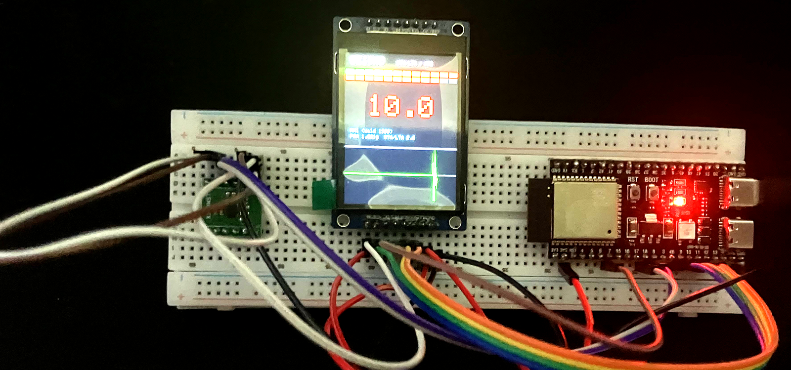
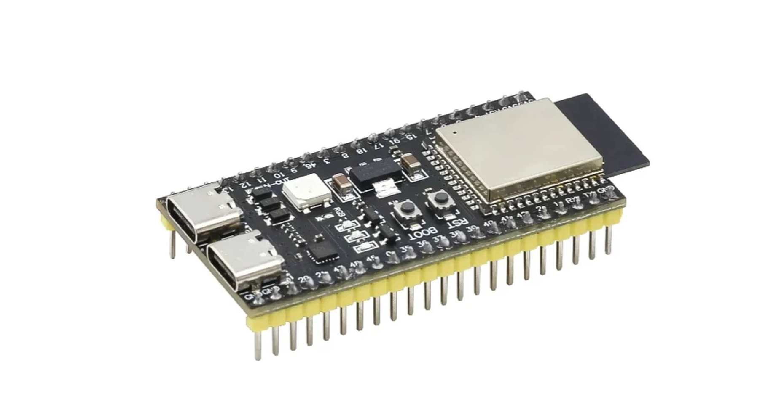
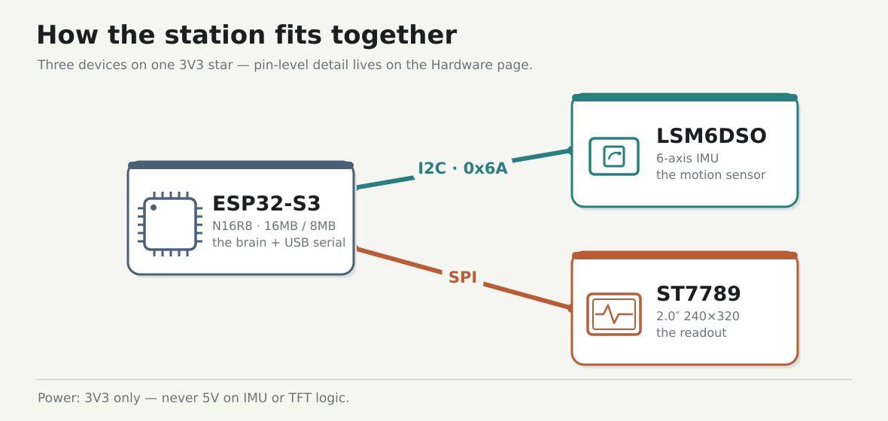

# ESP32-S3 seismo

A desk seismometer you can wire yourself — thump the table, watch the intensity climb on the TFT.

The finished station — a desk slam drives MMI to 10, orange bar full, waveform spiking.

N16R8, dual Type-C — the brain of the station.

## Story

This started as a parts pile: an ESP32-S3, a cheap LSM6DSO breakout, and a bright little ST7789. The goal was never a fleet or a cloud pipeline — just a **local station** on Ubuntu you can follow phase by phase, until a desk thump lights **EVENT** and a Wald-style **MMI** number.

v1 bring-up runs through Phase 7 and is done. Each phase stays a frozen snapshot so you can replay the exact path; later extras (buzzer, microSD, SoftAP) land as new folders, never rewrites of old ones.

!!! note "A learning demo, not a real seismometer"
    This is a bench project to learn the sensor → display pipeline. A breadboard IMU isn't calibrated or ground-coupled, so the **MMI** readout is illustrative only — not a real earthquake measurement.

The shape of it — S3 talks to the IMU over I2C and the TFT over SPI. Pin-level wiring is on the [Hardware](hardware.md) page.

## Start here

Runs on Ubuntu. Follow the phases in order, one checkpoint at a time.

| Doc | Role |
|-----|------|
| [Prerequisites](prerequisites.md) | Install the tools — assume nothing |
| [Hardware](hardware.md) | Parts, pin map, wiring |
| [Firmware](firmware.md) | Per-phase `firmware/<nn>-…/` folders |
| [Phase 0 → 7](phases/00-usb-erase.md) | The bring-up walkthrough, one checkpoint at a time |
| [Lab log](lab-log.md) | Bench scoreboard — wins and failures |
