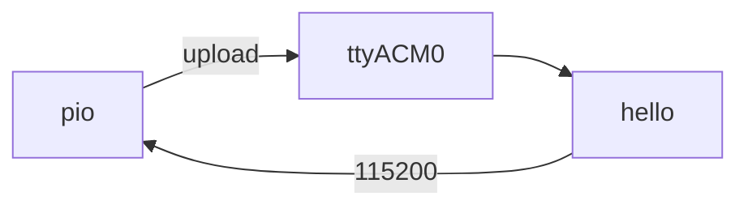

# Phase 1 — Hello flash

Build, flash, and read serial on the erased N16R8. No IMU or TFT yet — just prove the tool chain.



## Firmware

**Changed — first app.** Standalone tree [`firmware/01-hello/`](../../firmware/01-hello/) — leave it alone later; new phases get new folders. Tracker: [Firmware](../firmware.md).

## Preconditions

- [Prerequisites](../prerequisites.md) done (`pio` on `PATH`)
- [Checkpoint 0](00-usb-erase.md) passed
- Board on **COM** → `/dev/ttyACM0`

---

## 1.1 Build

<div class="run" markdown>

```bash
cd firmware/01-hello
pio run -e esp32-s3-n16r8
```

```text {.no-copy}
RAM:   [=         ]   8.1% (used 26700 bytes from 327680 bytes)
Flash: [=         ]   5.8% (used 380669 bytes from 6553600 bytes)
========================= [SUCCESS] Took 10.19 seconds =========================
```

</div>

---

## 1.2 Upload

<div class="run" markdown>

```bash
pio run -e esp32-s3-n16r8 -t upload --upload-port /dev/ttyACM0
```

```text {.no-copy}
Connecting....
Connected to ESP32-S3 on /dev/ttyACM0:
Chip type:          ESP32-S3 (QFN56) (revision v0.2)
Auto-detected flash size: 16MB
…
Hash of data verified.
Hard resetting via RTS pin...
========================= [SUCCESS] Took 10.32 seconds =========================
```

</div>

Stuck on `Connecting…`? Hold **BOOT**, tap **RST**, release **BOOT**, retry.

---

## 1.3 Serial

<div class="run" markdown>

```bash
pio device monitor -b 115200 --port /dev/ttyACM0
```

```text {.no-copy}
seismo hello — phase 1
MAC=28:84:85:8C:D0:40
chip=ESP32-S3 flash=16MB psram=8388608 bytes
seismo hello MAC=28:84:85:8C:D0:40 uptime_ms=602
seismo hello MAC=28:84:85:8C:D0:40 uptime_ms=1613
seismo hello MAC=28:84:85:8C:D0:40 uptime_ms=2613
```

</div>

MAC must match Phase 0 (`28:84:85:8C:D0:40`). Flash 16MB and PSRAM 8MB confirm the N16R8 image.

---

## Checkpoint 1

- [x] Build succeeds
- [x] Upload verifies (`Hash of data verified`)
- [x] Serial shows the hello line every ~1 s
- [x] Logged in [Lab log](../lab-log.md)

**Next:** [Phase 2 — Power the TFT](02-tft-power.md)
