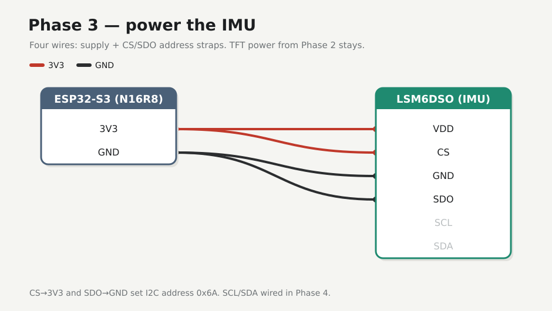

# Phase 3 — Power the IMU

Four wires: IMU supply plus **CS** / **SDO** address straps. TFT power from Phase 2 stays. No I2C data yet.

## Firmware

**Unchanged** — [`firmware/01-hello/`](../../firmware/01-hello/).

## Preconditions

[Checkpoint 2](02-tft-power.md) passed. IMU `VDD…CS` header on. Unplug USB while seating jumpers.

!!! warning
    Power the IMU from **3V3 only** — 5V on the logic can kill the module. After wiring, check for heat and ~3.3 V on VDD before trusting it.

---

## Wires



| From S3 | To |
|---------|-----|
| **3V3** | IMU **VDD**, IMU **CS** |
| **GND** | IMU **GND**, IMU **SDO** |

S3 underside — match silk. **CS→3V3** and **SDO→GND** set I2C address **0x6A** for the next phase. Leave IMU **SCL** / **SDA** and the left row open.

---

## Check

Plug COM. IMU cool. Meter ≈ 3.3 V on IMU VDD and IMU CS. TFT backlight still on. Hello still prints.

<div class="run" markdown>

```bash
pio device monitor -b 115200 --port /dev/ttyACM0
```

```text {.no-copy}
seismo hello MAC=28:84:85:8C:D0:40 uptime_ms=5080613
```

</div>

## Checkpoint 3

- [x] Those four IMU wires only (TFT power still on)
- [x] ~3.3 V on VDD and CS, no heat
- [x] Hello still prints
- [x] [Lab log](../lab-log.md)

**Next:** [Phase 4 — I2C scan](04-i2c-scan.md)
