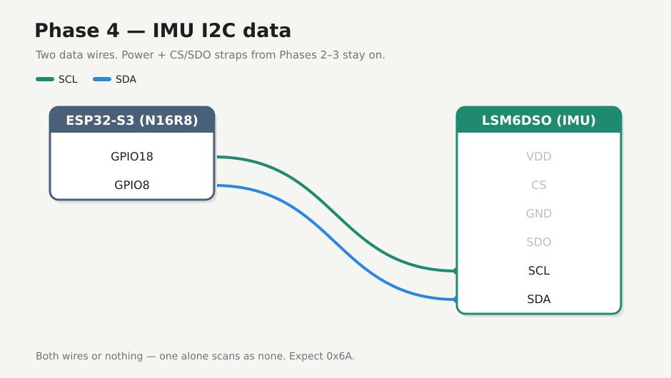

# Phase 4 — Wire IMU I2C + scan

Add **SDA** / **SCL** and confirm the LSM6DSO answers at **0x6A**. Power and straps from Phases 2–3 stay on.

## Firmware

**Changed.** New folder [`firmware/04-i2c-scan/`](../../firmware/04-i2c-scan/). Do not edit `01-hello`. Pins `SDA=8` `SCL=18`.

## Preconditions

- [Checkpoint 3](03-imu-power.md) passed
- Straps: CS→3V3, SDO→GND
- Unplug USB while seating the two data jumpers

---

## 4.1 Data wires



| S3 | IMU |
|----|-----|
| **GPIO8** | **SDA** |
| **GPIO18** | **SCL** |

**Both wires or nothing** — one alone → `found none`. Leave IMU left row open. Do not wire TFT SPI yet.

---

## 4.2 Flash scanner

Stop any serial monitor on COM first.

<div class="run" markdown>

```bash
cd firmware/04-i2c-scan
pio run -e esp32-s3-n16r8 -t upload --upload-port /dev/ttyACM0
```

```text {.no-copy}
Connected to ESP32-S3 on /dev/ttyACM0:
…
Hash of data verified.
Hard resetting via RTS pin...
========================= [SUCCESS] Took 9.17 seconds =========================
```

</div>

<div class="run" markdown>

```bash
pio device monitor -b 115200 --port /dev/ttyACM0
```

```text {.no-copy}
seismo i2c-scan — phase 4
SDA=GPIO8 SCL=GPIO18 expect=0x6A (CS→3V3 SDO→GND)
--- i2c scan ---
found 0x6A
found 0x7E
devices=2
```

</div>

Expect **0x6A** and **0x7E** every scan. Pass on **0x6A**. **0x7E** is not the IMU.

## 4.3 If no device

- Confirm both wires seated (see above)
- Recheck SDA/SCL not swapped
- Try SDO→3V3 (address becomes **0x6B**) and re-scan
- Shorter jumpers; shared GND confirmed

## Checkpoint 4

- [x] Serial scan lists **0x6A** (or documented 0x6B fallback)
- [x] Address stable across resets
- [x] Logged in [lab-log.md](../lab-log.md)

**Stop here until checkpoint passes.**

**Next:** [Phase 5 — Accel stream](05-accel-stream.md)
