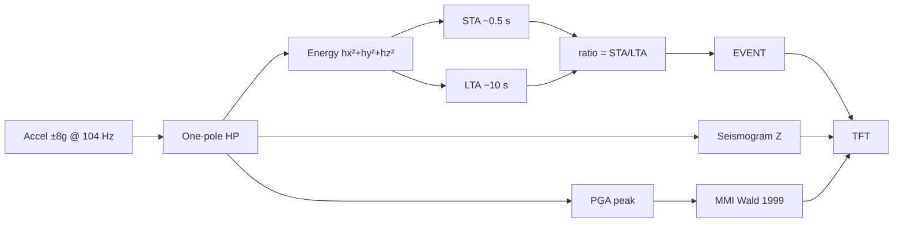

# Phase 7 — Intensity demo (MMI)

Thump the desk or tap the IMU: after a short **warmup**, **EVENT** fires from **STA/LTA**, the seismogram jumps, and **MMI** climbs from peak acceleration. No new wires.


As built — a hard slam drives MMI to 10, orange bar full, waveform spiking. IMU (left), ESP32-S3 (right), colour-coded jumpers across the star.

## Firmware

[`firmware/07-intensity-ui/`](../../firmware/07-intensity-ui/) · [`src/main.cpp`](../../firmware/07-intensity-ui/src/main.cpp)

## Preconditions

- [Checkpoint 6](06-tft-fill.md) passed
- IMU solid enough that a desk thump couples into it

---

## 7.1 Demo

1. Flash (see 7.2). Screen shows **WARMUP** while the long-term average fills (~10 s — keep still).
2. When live: quiet baseline → **MMI 0**, **STA/LTA** ~1, flat green seismogram.
3. **Thump the table** or tap the IMU.
4. Ratio spikes → red **EVENT**; big number is **MMI** (I–XII). Banner drops quickly.
5. Hit again anytime — intensity updates with each shake.

Serial: `[armed] MMI=… pga=… ratio=…` and `*** EVENT ***` on a trigger.



| On screen | From |
|-----------|------|
| Green/red wave | High-passed vertical **Z** |
| Big number | **Modified Mercalli Intensity** from PGA |
| EVENT | STA/LTA crossed `RATIO_TRIGGER` |
| Color bar | MMI I … XII |

### Intensity scale (Wald et al. 1999)

Raw instrumental estimate (no desk attenuation factor):

Wald et al. 1999 (instrumental estimate, no desk fudge factor):

```text
MMI = 3.66 * log10(PGA_cm_per_s2) - 1.66
```

PGA in cm/s², then clamped to I–XII. Idle below `PGA_QUIET_G` shows 0.

| Sensor PGA | ≈ MMI |
|------------|-------|
| 0.05 g | ~IV |
| 0.1 g | ~VI |
| 0.5 g | ~VIII |
| 1 g | ~IX–X |
| **≥ 5.5 g** | **XII** |

Sensor is **±8 g** so XII is reachable (Wald XII needs ~5.5 g). ±2 g would clip near X.

!!! note "This is a demo, not a seismometer"
    A breadboard LSM6DSO has no calibration, no seismic mounting, and no ground coupling. The MMI number is a fun illustration of the STA/LTA → PGA → intensity pipeline — it is **not** a real earthquake measurement. Don't use it for anything that matters.

---

## 7.2 Flash

Stop any serial monitor on COM first.

<div class="run" markdown>

```bash
cd firmware/07-intensity-ui
pio run -e esp32-s3-n16r8 -t upload --upload-port /dev/ttyACM0
```

```text {.no-copy}
…
Hash of data verified.
Hard resetting via RTS pin...
========================= [SUCCESS] Took … seconds =========================
```

</div>

<div class="run" markdown>

```bash
pio device monitor -b 115200 --port /dev/ttyACM0
```

```text {.no-copy}
seismo — STA/LTA + MMI (Wald 1999)
MMI = 3.66*log10(PGA_cm/s2)-1.66  XII@>=5.48g  FS=±8g
[armed] MMI=0.0 pga=0.002 ratio=1.2
*** EVENT ***  ratio=18.4  PGA=0.210g  MMI=6.8
```

</div>

---

## 7.3 Customize

Edit the **`CUSTOMIZE`** block in `main.cpp`, rebuild/flash.

| Want… | Change |
|-------|--------|
| More sensitive EVENT | Lower `RATIO_TRIGGER` |
| Fewer false events | Raise `RATIO_TRIGGER` or `N_LTA` |
| Idle still shows MMI > 0 | Raise `PGA_QUIET_G` |
| Banner stays longer | Raise `EVENT_HOLD_MS` |
| Wave taller | Lower `WAVE_FULL_SCALE_G` |

---

## Checkpoint 7

- [x] Warmup completes; quiet MMI 0
- [x] Desk thump → EVENT + MMI; hard slam can reach XII
- [x] Knobs documented

**v1 bring-up complete.**
