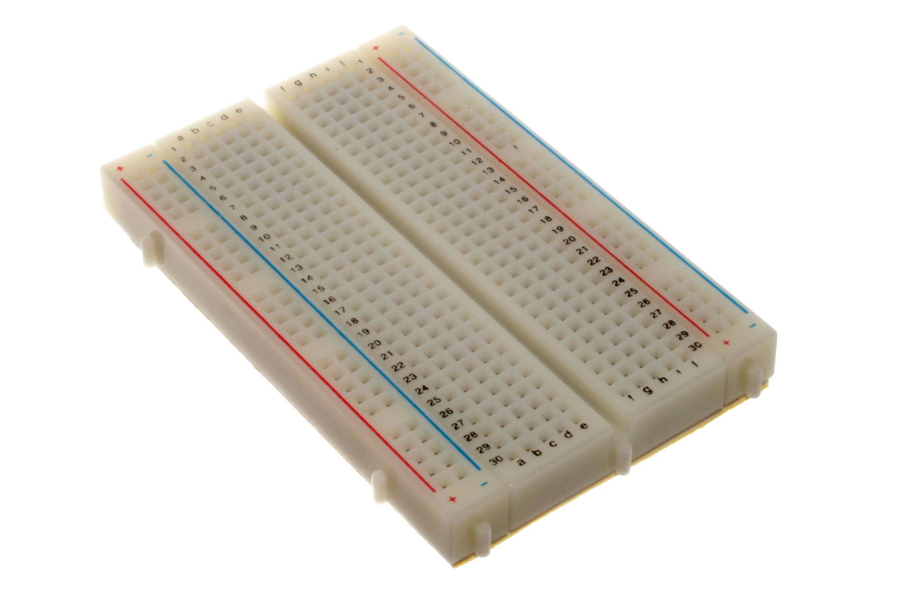

# Prerequisites

This demo is written against **Ubuntu 24.04 LTS**.

## What you need on the desk

| Item | Notes |
|------|-------|
| PC | USB host port that does data |
| ESP32-S3 N16R8 | Dual Type-C DevKitC-class board |
| LSM6DSO module | Headers for later phases |
| Estardyn 2.0″ ST7789 | 8-pin header on |
| Solderless breadboard | Half-size (400) or full (830) — enough for a 3V3/GND star |
| DuPont jumpers | M–M (and M–F if modules need them) |
| USB-C **data** cable | Charge-only cables never enumerate |



How the holes are already tied together (before any project wires): [Hardware — Breadboard](hardware.md#breadboard-default-connectivity). Parts and silk: [Hardware](hardware.md).

---

## 1. Base packages

<div class="run" markdown>

```bash
sudo apt-get update
sudo apt-get install -y git curl python3
```

```text {.no-copy}
…
Setting up python3 …
Setting up curl …
```

</div>

Check:

<div class="run" markdown>

```bash
git --version
python3 --version
curl --version | head -1
```

```text {.no-copy}
git version 2.x.x
Python 3.12.x
curl 8.x.x …
```

</div>

---

## 2. Clone this repo

<div class="run" markdown>

```bash
git clone https://github.com/jajera/esp32-s3-seismo.git
cd esp32-s3-seismo
```

```text {.no-copy}
Cloning into 'esp32-s3-seismo'...
…
```

</div>

(Use your fork URL if that’s what you’re working from.)

---

## 3. Install PlatformIO Core

Official installer into `~/.platformio/penv` (no `sudo`):

<div class="run" markdown>

```bash
curl -fsSL https://raw.githubusercontent.com/platformio/platformio-core-installer/master/get-platformio.py -o /tmp/get-platformio.py
python3 /tmp/get-platformio.py
```

```text {.no-copy}
…
PlatformIO Core has been successfully installed into ~/.platformio/penv
```

</div>

Put `pio` / `esptool` on your `PATH` for this shell (and add the same line to `~/.bashrc` if you want it permanent):

<div class="run" markdown>

```bash
export PATH="$PATH:$HOME/.platformio/penv/bin"
pio --version
esptool version
```

```text {.no-copy}
PlatformIO Core, version 6.1.19
esptool v5.3.0
```

</div>

Don’t use `sudo pio`. First `pio run` will download the Espressif platform and toolchains — that needs network and can take several minutes.

---

## 4. Docs site (authors only — skip for the lab)

Only needed if you want to preview or edit this walkthrough. The lab phases don’t require it.

<div class="run" markdown>

```bash
sudo apt-get install -y python3-venv
python3 -m venv .venv
.venv/bin/pip install -r requirements.txt
```

```text {.no-copy}
…
Successfully installed zensical-… zensical-patina-…
```

</div>

Serve locally at `http://127.0.0.1:8000`:

<div class="run" markdown>

```bash
.venv/bin/zensical serve
```

```text {.no-copy}
Serving on http://127.0.0.1:8000
```

</div>

---

## Checkpoint — prerequisites

You’re ready for Phase 0 when:

- [ ] `git`, `python3`, and `curl` work
- [ ] Repo is cloned and you’re in its root
- [ ] `pio --version` and `esptool version` work **without** sudo
- [ ] Hardware, breadboard, jumpers, and a data cable are on the desk
- [ ] *(authors only)* `.venv/bin/zensical serve` comes up

**Next:** [Phase 0 — USB erase](phases/00-usb-erase.md) (udev + `dialout`, then plug the board).
